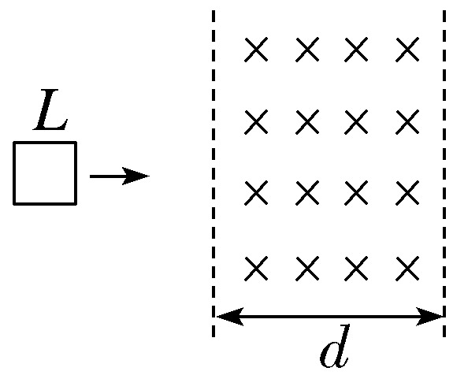
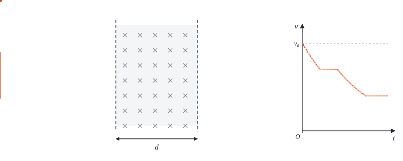

# 作业答案与作业问答（p.phylab.uk/answers/、p.phylab.uk/tutor/）

这个文件夹是网站上两个页面的全部源文件：

| 网址 | 源文件 | 用途 |
|---|---|---|
| `/answers/`（`/answers/x2/`、`/answers/x2/solution/#k15/3`） | `answers.html` | 对答案、看解析（默认对答案） |
| `/tutor/`（`/tutor/#x2/k15/3`） | `screen.html` | 一体机大屏上的苏格拉底式问答（DeepSeek） |

两个页面都只读 `data.js`，`data.js` 由 `build.py` 从 `content/` 编译出来，**不要手改**。
网址的整理（文件夹式网址、旧网址跳转）在 `scripts/build-site.mjs` 里完成，仓库里的文件按下面的结构放即可。

## 目录

```
tutor/
├── answers.html        对答案 / 看解析页面
├── screen.html         大屏问答页面（给 DeepSeek 的系统提示词在这里拼）
├── build.py            content → data.js（并给 data.js 打缓存指纹）
├── data.js             生成文件
├── extract_stems.py    从作业本 docx 提取题干（旧流程，必修一用过）
├── content/            正式内容：每本书一个文件夹
│   ├── bx1/            必修一作业本      网址里叫 b1
│   ├── xx1/            选修一作业本      网址里叫 x1
│   ├── xx2/            选修二作业本      网址里叫 x2
│   └── exams/          考试讲评          网址里叫 exam（学生手上已有答案，AI 只答疑）
│       每个文件夹里：chapters.txt（章节顺序）+ topics/<章节id>*.md（每节一个文件）
├── guides/             问答脚本的原稿，按书分文件夹（bx1/ xx1/ xx2/ exams/）
│   └── insert_guides.py   把原稿插进 content 里对应题目的「**问答脚本**」块
├── assets/             题图、解析配图、动画（按书分文件夹，md 里用 assets/... 引用）
└── tools/
    ├── docx_to_topics.py   从三维设计教师用书 docx 生成一节的草稿（题干、答案、原书解析、配图）
    ├── animations/         解析里的动画演示（SVG 动画，生成后放进 assets/xx2）
    │   ├── anim.py         第一章：带电粒子轨迹
    │   └── anim2.py        第二章：导体运动 + 同步画出的 v-t / i-t 图像
    └── exam-lock/          考试讲评定时解锁
```

## 每道题的 md 写法

```
## 3. 单选 · 线框穿过条形磁场的 v-t 图像      ← 题号. 题型 · 小标题

**题目**                                      ← 大屏显示；答案页不显示
……题干、选项、

**答案：D**

**解析**                                      ← 答案页显示；也会交给 DeepSeek

……

**问答脚本**                                  ← 只交给 DeepSeek，答案页不显示
本题考点 / 已知 / 提问路线（1. 问：… → 期望：…）/ 选项要点 / 常见错误（追问）/ 总结句
```

大屏只显示同时有「题目」和「问答脚本」的题。进度条格数 = 提问路线里「数字. 问：」的行数（最多 7 格）。

## 加一节新作业（以选修二为例）

1. 在 `content/xx2/chapters.txt` 里按教参目录加一行 `k21 | 第三章 1.交变电流`。
2. `python3 tutor/tools/docx_to_topics.py`（改脚本里的章节表）从教师用书生成草稿和配图。
3. 逐题补小标题、整理解析；在 `guides/xx2/k21.md` 写问答脚本，`python3 tutor/guides/insert_guides.py xx2/k21` 插入。
4. 需要动画的题，在 `tools/animations/` 里加一个函数生成 SVG，再在解析开头加一行 ``。
5. `python3 tutor/build.py`，推送到 main，GitHub Actions 自动部署。
